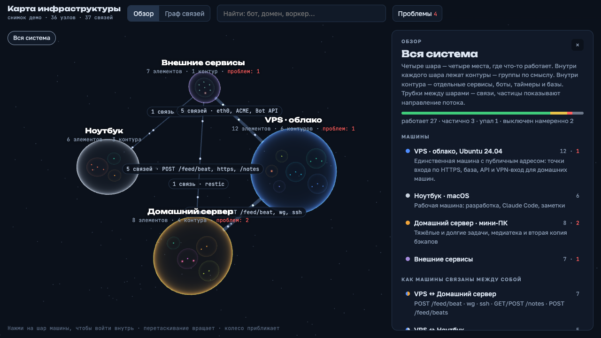

# Infra Map — интерактивная 3D-карта домашней инфраструктуры

Карта всего, что работает на нескольких машинах: службы, таймеры, контейнеры, базы, боты, внешние сервисы
и связи между ними. Машины — светящиеся шары, внутри них контуры (группы по смыслу), внутри контуров — узлы.
Клик по шару — вход внутрь, клик по узлу — карточка: зачем он нужен, как устроен, на чём сделан и с чем связан.
Второй режим — граф связей (force-directed, 2D/3D).



В репозитории — вымышленная демо-инфраструктура (VPS, домашний сервер, ноутбук и внешние сервисы).
Оригинал строился по живой инвентаризации трёх машин: 440 узлов и почти 900 связей.

## Как это собирается

```
inventory/*.md  ──parse_inventory.py──►  узлы и связи  ──assemble.py──►  data/infra.json  ──build.py──►  dist/infra-map.html
(Markdown на машину)                                      (+ meta.json, problems.md)                      (один файл, офлайн)
```

1. **Инвентаризация** — по Markdown-файлу на машину. Формат простой и удобный для агента, который обходит
   машину только чтением (`systemctl list-timers`, `docker ps`, конфиги nginx, crontab, LaunchAgents):

   ```markdown
   ### backup-timer
   - name: crm-backup.timer
   - host: vps
   - kind: timer
   - group: backup
   - status: up
   - purpose: Ночной дамп базы, шифрование, хранение трёх последних копий.
   - links:
     - -> postgres : pg_dump : дамп
     - <- restic-pull : ssh : забор копий
   ```

2. **Сборка** (`tools/assemble.py`) проверяет то, что ломало карту на живых данных: связи на несуществующие
   узлы, неизвестные машины и контуры, статусы вне словаря, дубли — и печатает всё списком, а не падает на
   первой ошибке. Машины, контуры и их описания — в `inventory/meta.json`, найденные проблемы — в `problems.md`.
3. **Вьюер** (`viewer.html`) — одна страница на three.js + 3d-force-graph. `tools/build.py` встраивает в неё
   данные и библиотеки, выкидывает повторяющиеся предложения из описаний и выдаёт самодостаточный HTML,
   который открывается двойным кликом без сервера и интернета.

## Запуск

```sh
python3 tools/assemble.py      # inventory/ → data/infra.json
python3 tools/build.py         # → dist/infra-map.html (библиотеки скачиваются один раз в tools/vendor/)
open dist/infra-map.html
```

Нужен только Python 3.10+ без сторонних пакетов.

## Что на карте

- статусы узлов: работает, частично, упал, не запущен, выключен намеренно, законсервирован, не проверен;
- счётчик проблем по каждой машине и сводка «Найдено при разборе»;
- связи между машинами агрегируются в «трубки» с подписью каналов (HTTP, ssh, WireGuard…);
- поиск по названию, фильтры по машине, статусу и контуру;
- на телефоне правая панель становится нижней шторкой.

## Стек

JavaScript (three.js 0.147, 3d-force-graph, force-graph), HTML/CSS; Python для сборки.

## Лицензия

MIT — см. `LICENSE`. three.js, 3d-force-graph и force-graph распространяются под MIT своими авторами.
